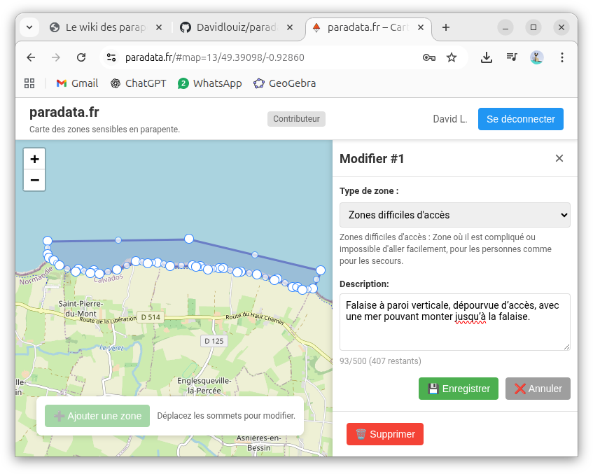

<div align="center">

# 🪂 paradata.fr

**La carte collaborative des zones sensibles du parapente.**

SPA de cartographie où chacun peut **consulter** les zones (décollages, atterrissages,
zones de préparation, accès difficiles, zones isolées) et où les **contributeurs
authentifiés** les créent, les modifient et les suppriment — avec verrous d'édition,
quotas quotidiens et piste d'audit complète.




**Lecture publique · Écriture authentifiée · Verrous collaboratifs · Audit complet**

https://paradata.fr · [Dépôt GitHub](https://github.com/Davidlouiz/paradata)

</div>

---

## ✨ Fonctionnalités

| | |
|---|---|
| 🗺️ **Carte interactive** | Zones dessinées en GeoJSON (`Polygon` / `MultiPolygon`) avec Leaflet |
| 👀 **Lecture publique** | La carte et les zones sont visibles sans compte |
| 🔒 **Écriture authentifiée** | Création / modification / suppression réservées aux comptes connectés |
| 🔄 **Verrous collaboratifs** | Verrou de **15 min** par zone pour éviter les conflits d'édition |
| 📊 **Quotas quotidiens** | **15 CREATE** · **5 UPDATE** · **5 DELETE** par utilisateur et par jour |
| ♻️ **Annulation de suppression** | `GRACE_DELETE` restaure un CREATE pendant **120 min** |
| 📝 **Audit complet** | Chaque écriture est tracée dans `audit_log` (source des quotas) |
| ⚡ **Temps réel** | Événements Socket.IO : `zone_created`, `zone_updated`, `zone_deleted`, `zone_locked`, `zone_released` |
| 🗑️ **Suppression logique** | Soft delete via `deleted_at`, aucune perte de données |

---

## 🛠️ Stack technique

Le projet met en œuvre une stack **Python + JavaScript vanilla**, pensée pour rester
simple à déployer et à opérer sur un petit serveur :

- **[FastAPI](https://fastapi.tiangolo.com/)** — API REST asynchrone, validation Pydantic et documentation OpenAPI générée (`/docs`).
- **[Python 3.11](https://www.python.org/)** — runtime du backend (image `python:3.11-slim` en production).
- **[Uvicorn](https://www.uvicorn.org/)** — serveur ASGI ; l'application est servie via `app.main:socket_app` pour que les WebSockets fonctionnent.
- **[Socket.IO](https://python-socketio.readthedocs.io/)** — diffusion temps réel des créations, mises à jour, suppressions et verrous de zones.
- **[SQLite](https://www.sqlite.org/)** — base locale sans serveur (`users`, `zones`, `zone_types`, `audit_log`, tables anti-brute-force), clés étrangères activées.
- **[Shapely](https://shapely.readthedocs.io/)** — validation géométrique et détection des recouvrements entre zones.
- **[JWT (HS256)](https://pyjwt.readthedocs.io/) + [bcrypt](https://github.com/pyca/bcrypt)** — jetons de 30 jours stockés dans `localStorage`, mots de passe hashés.
- **[Leaflet 1.9](https://leafletjs.com/) + [Leaflet-Geoman](https://geoman.io/)** — carte interactive et édition des polygones côté navigateur.
- **[JavaScript vanilla](https://developer.mozilla.org/fr/docs/Web/JavaScript)** — SPA sans framework dans [`static/js`](static/js), consommation de l'API via `fetch`.
- **[Docker](https://www.docker.com/) + [Nginx](https://nginx.org/)** — image de production, reverse proxy et terminaison TLS (`docker compose` pour le dev).

---

## 🚀 Démarrage local

```bash
git clone https://github.com/Davidlouiz/paradata.git
cd paradata

# Mode développement avec Docker (recommandé)
docker compose -f docker-compose.dev.yml up -d

# Ou sans Docker
python -m venv .venv
source .venv/bin/activate
pip install -r requirements.txt
uvicorn app.main:socket_app --reload
```

Accédez à **http://localhost** (ou http://paradata.fr si configuré dans `/etc/hosts`)

---

## 📚 Documentation

- **[DEPLOYMENT-DOCKER.md](DEPLOYMENT-DOCKER.md)** - Déploiement en production
- **[COMMANDS.md](COMMANDS.md)** - Commandes utiles
- **[SECURITY.md](SECURITY.md)** - Bonnes pratiques de sécurité
- **[.github/copilot-instructions.md](.github/copilot-instructions.md)** - Architecture détaillée

## 🔐 Sécurité

- ✅ Authentification JWT HS256
- ✅ Passwords hashés (bcrypt)
- ✅ CORS restrictif
- ✅ Quotas par utilisateur (CREATE/UPDATE/DELETE)
- ✅ Verrous collaboratifs
- ✅ Audit complet
- ✅ Suppression logique (soft delete)

Voir [SECURITY.md](SECURITY.md) pour le guide complet.

## 📋 Quotas

Par utilisateur et par jour :

| Action | Limite |
|--------|--------|
| CREATE | 15 zones |
| UPDATE | 5 zones |
| DELETE | 5 zones |
| GRACE_DELETE | Restaure 1 CREATE (120 min) |

## 🔄 Verrous collaboratifs

- Durée : 15 minutes
- Évite les conflits d'édition
- Libération automatique après `PUT` ou manuelle via `POST /zones/{id}/release`
- Consultation du statut : `GET /zones/{id}/lock`

## 📝 Format de l'API

Chaque réponse : `{ success, data, error? }`

**Types de zones acceptés :**
- `DIFFICULT_ACCESS` - Zones difficiles d'accès
- `REMOTE_AREA` - Zone reculée
- `TAKEOFF` - Décollage
- `LANDING` - Atterrissage
- `PREPARATION_ZONE` - Zone de préparation

**Géométrie :** GeoJSON `Polygon` ou `MultiPolygon`

## 🤝 Contribution

Les contributions sont bienvenues !

```bash
git checkout -b feature/ma-fonctionnalite
git add .
git commit -m "feat: description"
git push origin feature/ma-fonctionnalite
```

Ouvrez une Pull Request.

## 📄 Licence

MIT

## 💻 Auteur

**David Louise** - [@Davidlouiz](https://github.com/Davidlouiz)

---

## 🔗 Liens

- **Site** : https://paradata.fr
- **Dépôt** : https://github.com/Davidlouiz/paradata
- **API Docs** : https://paradata.fr/docs
- **Issues** : https://github.com/Davidlouiz/paradata/issues
